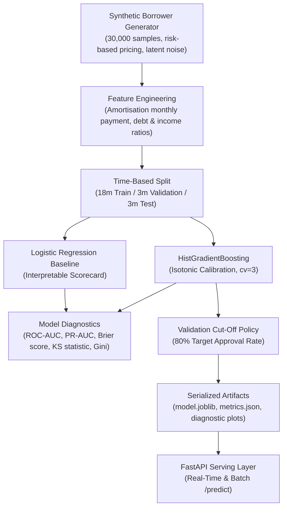
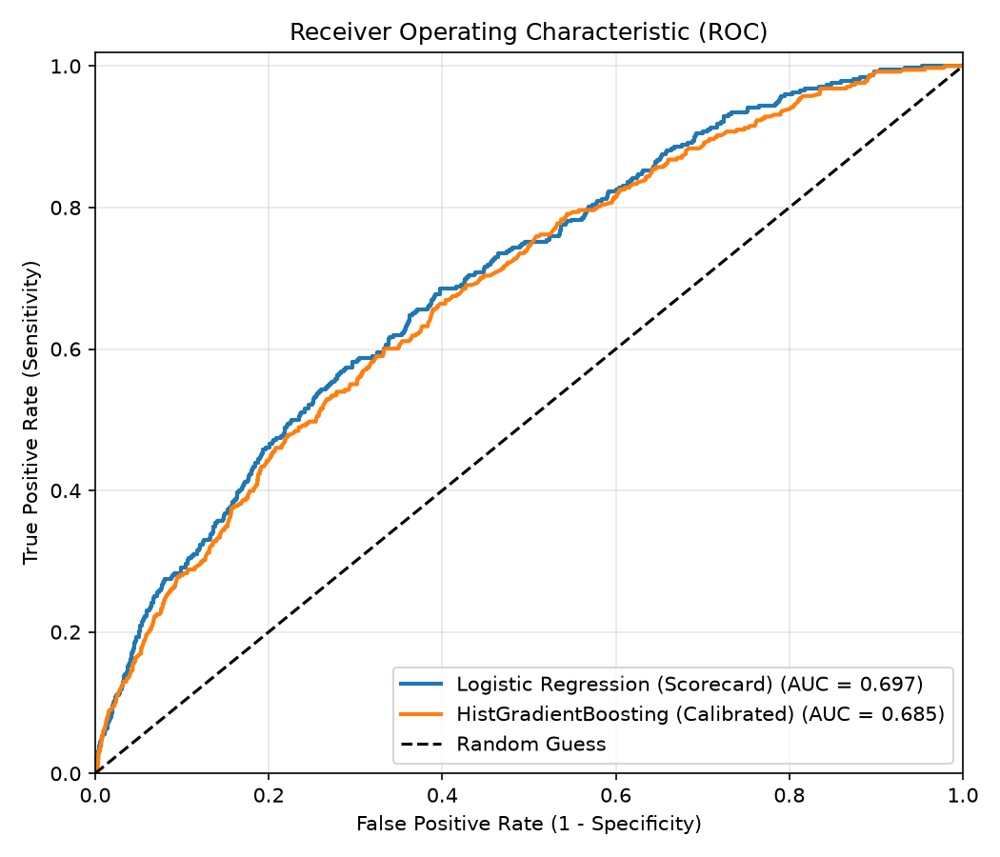
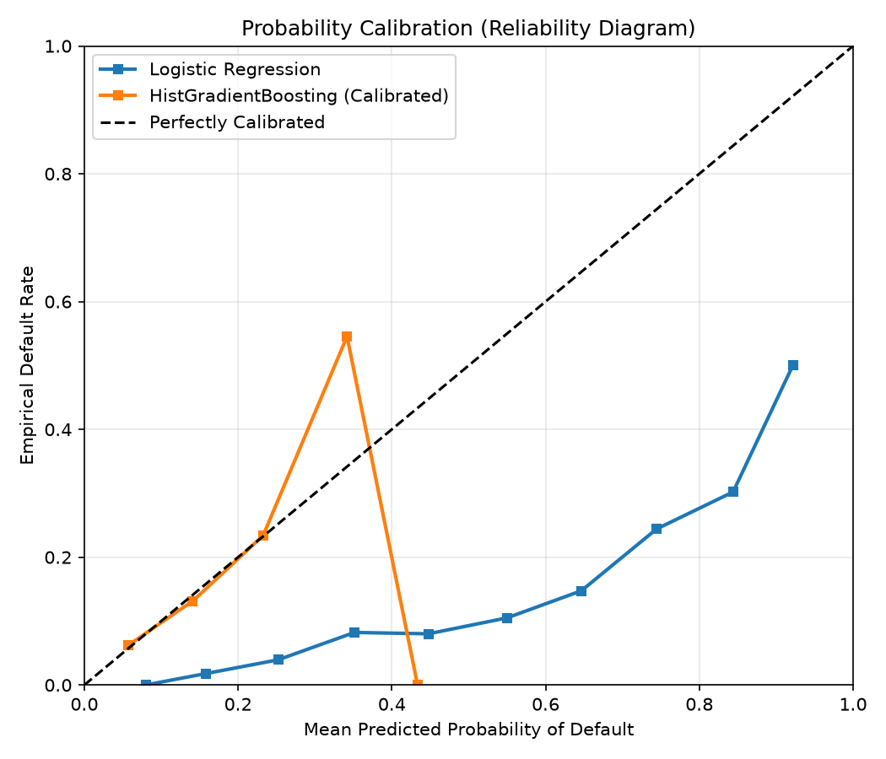
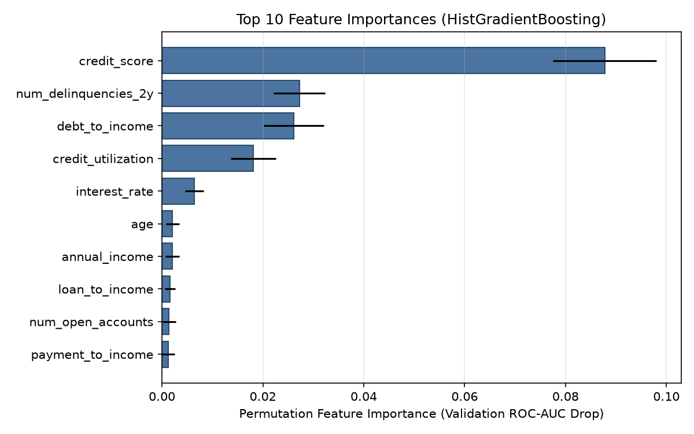

# Loan Default Prediction & Credit Risk Scoring

[](https://github.com/pulok529/loan_default_prediction/actions/workflows/ci.yml)


[](LICENSE)

An end-to-end machine learning system for estimating borrower probability of default (PD), calibrating risk scores, and generating explainable credit underwriting decisions.



---

## Data

The dataset consists of 30,000 synthetic borrower application records spanning a 24-month horizon (starting `2024-01-01`).

### Why Synthetic Data?
Real credit bureau and banking loan default records contain proprietary personal financial information (PII) subject to strict banking secrecy and privacy regulations (e.g., GDPR, FCRA). The data generator in `src/loan_default/data.py` simulates realistic borrower distributions without exposing real consumer records:
- **Risk-based pricing**: Lower credit scores correlate with higher assigned interest rates, plus stochastic variance.
- **Latent noise**: Default outcomes are generated via a logistic model driven by debt-to-income, credit score, interest rate, utilization, and delinquencies, plus an unobserved latent disturbance term ($\sigma \sim 1.0$) so the classes are not trivially separable.
- **Calibrated base rate**: Intercept calibration sets overall empirical default rates to approximately 10% (8%–12%).
- **Realistic missingness**: Approximately 3% missing values are injected into `employment_years` and `annual_income` to test imputer robustness.

---

## Modelling Choices

### 1. Time-Based Validation Split
In credit underwriting, models operate on future loan cohorts rather than randomly held-out historical applicants. To prevent temporal data leakage, data is split chronologically:
- **Train**: First 18 months (Months 1–18, before `2025-07-01`)
- **Validation**: Subsequent 3 months (Months 19–21, `2025-07-01` to `2025-10-01`)
- **Test**: Final 3 months (Months 22–24, `2025-10-01` onward)

### 2. Model Architectures
- **Baseline Scorecard (`LogisticRegression`)**: Standard benchmark in regulatory banking. Fitted with `class_weight="balanced"` and `max_iter=2000` to serve as a transparent, interpretable baseline.
- **Nonlinear Model (`HistGradientBoostingClassifier`)**: Captures nonlinear interactions between debt ratios and credit history.
- **Probability Calibration (`CalibratedClassifierCV`)**: Raw ensemble probabilities often deviate from true posterior default frequencies. The tree pipeline is calibrated using 3-fold cross-validation with isotonic regression on the training split, ensuring predicted probabilities match actual empirical default rates.

### 3. Industry-Standard Credit Risk Metrics
In financial risk assessment, accuracy is unsuitable due to class imbalance. The evaluation suite focuses on:
- **ROC-AUC & PR-AUC**: Measures global ranking ability across positive and negative instances.
- **Brier Score**: Measures probability calibration error ($(\hat{p} - y)^2$).
- **Kolmogorov-Smirnov (KS) Statistic**: $\max(\text{TPR} - \text{FPR})$. Quantifies maximum separation between default and non-default cumulative distributions. A standard regulatory hurdle metric for credit scorecards.
- **Gini Coefficient**: $2 \times \text{AUC} - 1$. Measures discriminatory power scaled from 0 (random) to 1 (perfect separation).

---

## Approval Policy

Rather than using an arbitrary 0.50 threshold, lenders establish underwriting policies based on portfolio risk targets and volume goals:
1. On the validation set, the cut-off threshold is selected to achieve a target **80% approval rate** (approving the 80% of applicants with the lowest estimated default probabilities).
2. The chosen cut-off is then applied to the holdout test set to evaluate out-of-time performance:
   - Realized test approval rate
   - Default rate among approved applicants vs. overall population default rate

---

## Results

Out-of-time test set = applications from months 22-24 (3,816 loans, 9.9% default). Trained with `python -m loan_default.train --n 30000`.

| Model | ROC-AUC | PR-AUC | Brier | KS | Gini |
|---|---|---|---|---|---|
| Logistic Regression (scorecard) | 0.697 | 0.219 | 0.217 | 0.287 | 0.395 |
| HistGradientBoosting (isotonic-calibrated) | 0.685 | 0.201 | 0.085 | 0.267 | 0.369 |

| Approval policy (cut-off chosen on validation for 80% approval) | Test |
|---|---|
| Approval rate | 80.7% |
| Default rate among approved | 7.5% |
| Default rate overall | 9.9% |

**Reading the numbers.**
- **Ranking:** the default outcome includes unobserved borrower risk on purpose, so ROC-AUC around 0.70 (Gini 0.39, KS 0.29) is in the range typical of application scorecards.
- **Model choice:** the simple logistic scorecard ranks slightly better than gradient boosting here because the simulated risk is close to linear in log-odds.
- **Calibration:** the calibrated boosting model has much better probabilities (Brier 0.085 vs 0.217). The class-balanced logistic model over-predicts risk, so the calibrated model is the one the API serves.
- **Policy effect:** approving the lowest-risk 80% cuts the portfolio default rate from 9.9% to 7.5%.
- **Top drivers** (permutation importance): credit score, recent delinquencies, debt-to-income, credit utilisation.

<p align="center">
  
  
  
</p>

---

## Quick Start

### Local Setup

```bash
# Clone the repository
git clone https://github.com/pulok529/loan_default_prediction.git
cd loan_default_prediction

# Create and activate virtual environment
python -m venv .venv
source .venv/bin/activate  # On Windows: .venv\Scripts\activate

# Install dependencies and local package in editable mode
pip install -r requirements-dev.txt
pip install -e .

# Train model and generate artifacts
python -m loan_default.train --n 30000 --out artifacts/

# Run unit and integration tests
pytest -q

# Run linter
ruff check .

# Start FastAPI server
uvicorn api.main:app --host 0.0.0.0 --port 8000 --reload
```

### Docker Setup

```bash
# Build Docker image (trains artifacts inside container build)
docker build -t loan-default:latest .

# Run container
docker run -p 8000:8000 loan-default:latest

# Check health endpoint
curl http://localhost:8000/health
```

---

## API Documentation & Examples

### Health Check

```bash
curl http://localhost:8000/health
```

Example response:
```json
{
  "status": "ok",
  "model_version": "1.0.0"
}
```

### Score an Applicant (`POST /predict`)

```bash
curl -X POST http://localhost:8000/predict \
  -H "Content-Type: application/json" \
  -d '{
    "loan_amount": 15000.0,
    "annual_income": 75000.0,
    "age": 35,
    "employment_years": 6.0,
    "home_ownership": "mortgage",
    "purpose": "debt_consolidation",
    "term_months": 36,
    "interest_rate": 0.11,
    "debt_to_income": 0.22,
    "credit_score": 720.0,
    "num_open_accounts": 7,
    "num_delinquencies_2y": 0,
    "credit_utilization": 0.28
  }'
```

Example JSON response (values for illustrative purposes):
```json
{
  "probability_of_default": 0.0412,
  "risk_band": "A",
  "decision": "approve",
  "top_factors": []
}
```

If an applicant exhibits high credit risk indicators (e.g., credit score < 600, debt-to-income > 0.45, utilization > 0.80), the automated policy returns `"decision": "review"` and populates explainable adverse action factors:
```json
{
  "probability_of_default": 0.2845,
  "risk_band": "D",
  "decision": "review",
  "top_factors": [
    "High debt-to-income ratio (> 0.45)",
    "Low credit score (< 600)",
    "High credit utilization (> 0.80)"
  ]
}
```

### Batch Scoring (`POST /predict/batch`)

Accepts up to 1,000 applicant objects in a single JSON array payload:

```bash
curl -X POST http://localhost:8000/predict/batch \
  -H "Content-Type: application/json" \
  -d '[
    {
      "loan_amount": 10000.0,
      "annual_income": 60000.0,
      "age": 30,
      "employment_years": 4.0,
      "home_ownership": "rent",
      "purpose": "debt_consolidation",
      "term_months": 24,
      "interest_rate": 0.12,
      "debt_to_income": 0.30,
      "credit_score": 680.0,
      "num_open_accounts": 5,
      "num_delinquencies_2y": 0,
      "credit_utilization": 0.35
    }
  ]'
```

---

## Project Structure

```
loan_default_prediction/
├── .github/
│   └── workflows/
│       └── ci.yml               # GitHub Actions CI workflow (test matrix & Docker healthcheck)
├── api/
│   ├── __init__.py              # API package root
│   └── main.py                  # FastAPI application factory, routes, and Pydantic schemas
├── notebooks/
│   └── 01_credit_risk_walkthrough.ipynb # Step-by-step EDA, training, and diagnostics notebook
├── src/
│   └── loan_default/
│       ├── __init__.py          # Package version definition
│       ├── data.py              # Synthetic borrower generator and CSV persistence
│       ├── features.py          # Derived financial features and ColumnTransformer pipeline
│       ├── model.py             # Inference bundle loading, scoring, and rule explanations
│       └── train.py             # Training CLI, calibration, metrics, and visualization
├── tests/
│   ├── __init__.py              # Test suite root
│   ├── test_api.py              # Integration tests for FastAPI endpoints
│   ├── test_data.py             # Tests for data generator schema and default rates
│   └── test_features.py         # Tests for amortisation payment formula and imputer
├── .dockerignore
├── .gitignore
├── Dockerfile                   # Python 3.12-slim multi-stage container specification
├── LICENSE                      # MIT license
├── Makefile                     # Standard developer commands (install, train, test, lint, serve)
├── pyproject.toml               # Setuptools configuration, Ruff lint rules, and pytest settings
├── README.md                    # Project documentation
├── requirements.txt             # Core runtime dependencies
└── requirements-dev.txt         # Development, testing, and linting dependencies
```

---

## Limitations & Responsible-Use Note

- **Synthetic Data**: All applicant records, credit scores, and default events are synthetically generated. Distributions and relationships approximate real credit dynamics for portfolio demonstration purposes and do not represent actual borrowers or institutional underwriting policies.
- **Fair Lending & Regulatory Compliance**: Under regulatory frameworks such as the U.S. Equal Credit Opportunity Act (ECOA) and Fair Housing Act, certain borrower attributes cannot be used in credit underwriting decisions without strict justification. In this project, `age` is included solely to illustrate demographic feature handling in synthetic benchmarks; in production credit systems, age must be reviewed by compliance teams and may only be utilized in favorable scoring models under specific legal guidelines.
- **Model Governance**: Production credit risk deployments require continuous monitoring for population drift (PSI - Population Stability Index), characteristic drift (CSI), and adverse impact analysis across protected groups.

---

## Roadmap

- [ ] Add Population Stability Index (PSI) and Characteristic Stability Index (CSI) drift detection monitoring.
- [ ] Implement SHAP (SHapley Additive exPlanations) for local adverse action code extraction.
- [ ] Add Expected Loss (EL) calculations combining Probability of Default (PD), Loss Given Default (LGD), and Exposure at Default (EAD).
- [ ] Export ONNX model representations for ultra-low latency scoring environments.
